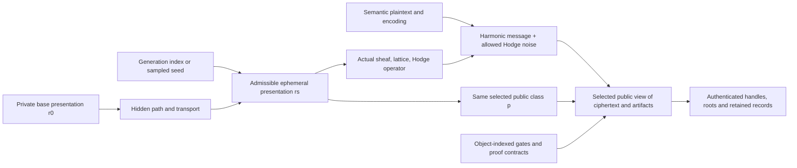
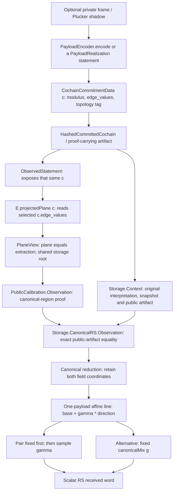

# Tracing cochain commitments through proximity

Current target, selected by the user: analyze the **actual cochain-commitment
projection and its radius**, rather than stop at a generic coding theorem.
The universal Paper 3 coding results remain independent of HCP and protocol
implementation. A commitment-specific application additionally fixes the
existing commitment/extraction profile and the source metric it claims to test.

This walkthrough records current definitions and proved comparisons. It does
not introduce a replacement commitment, identify distinct metrics without a
theorem, or claim that the application-specific projection is a new result.
The preserved pre-addition 2026-11-05 focused build validates the standalone coding aggregate and
the new sheaf/storage/optional canonical adapters (7,447 jobs). Expanded
axiom, full-workspace and manuscript/PDF outcomes are recorded separately in
the [shared validation record](../SEMANTIC-PARITY.md#mathematics-and-storage-follow-up).

## HCP object accounting, rotation and anonymity

This is a development crosswalk, dated 2026-11-05. It accounts for the objects
needed to connect the intended Helfer/Hodge family to the existing public,
gate and storage chain. It inventories definitions and joins; it does not
construct the missing family or strengthen a theorem. The eventual slim
Palomar entry should select its own required statements and proof closure.

A semantic record can retain hidden witnesses even when its name contains
“public”. Visibility must be specified by an actual selected public-view map.
The table therefore distinguishes a mathematical carrier from the fields
that an implementation publishes or persists.

### Semantic and Hodge objects

| ID | Object and source owner | Meaning, existing result and remaining join |
|---|---|---|
| HC01 | Hidden representative `Rep`; [HCPBridge.Realization](../lean/HCP.lean) | Index of a presentation, not a cochain, frame, digest or public class. The current realization is supplied; no intended concrete constructor is instantiated. |
| HC02 | [Helfer.Signature and Interpretation](../lean/Helfer/Signature.lean) | Sorts, operations, finite-product contexts and their categorical interpretation. A selected cellular complex still needs an actual interpretation adapter. |
| HC03 | [Helfer.HomotopyEquivalence](../lean/Helfer/HomotopyEquivalence.lean) | Function compatibility up to right homotopy, bifibrant sort objects and weak-equivalence components. Component homotopy inverses are proved. A quotient must first use bifibrant interpretations or chosen replacements; relation laws/setoid/quotient are not bundled here. |
| HC04 | [ClosedSemantics, ClosedTheory and ClosedFormulaInvariance](../lean/Helfer/Invariance.lean) | Formula carrier and satisfaction are supplied, as is invariance. Theory equality is proved from them. Full first-order syntax and Helfer's fibrational semantics are not constructed. A proved cohomological test fragment would need that precise label. |
| HC05 | [PublicClassifier, PublicFiber and HomotopyClassFingerprint](../lean/Axioms/HomotopyClass.lean) | Public class is classifier equality/inverse image. `Realization` factors it through closed theory. Only the forward equivalence-to-class direction is proved; neither classifier completeness nor an actual Helfer quotient follows. Fingerprint fields are not automatically computed invariants. |
| HC06 | [Path space and ClassMembershipWitness](../lean/Axioms/HelferFOL.lean) | A hidden path gives same-class membership under an explicit path-respecting classifier. Continuous paths, typed Helfer equivalence, classifier equality and equal matrix nullity are distinct relations. The legacy `HomotopyEquivalentLaplacians` in [Spectral](../lean/Laplacian/Spectral.lean) means equal kernel dimension only. |
| HC07 | [FiberSystem and TransportAdmissibility](../lean/Axioms/Fibration.lean) | Dependent fibers and a supplied path transport/invariant. Identity/composition coherence and a concrete metric-preserving action are not bundled. The categorical Grothendieck-fibration/tagged-copy construction in [Hardness](../lean/Hardness.lean) is a separate object, not the intended Helfer model. |
| HC08 | [OrientedTwoComplex](../lean/Sheaf/CellComplex.lean) and [CellularSheaf](../lean/Sheaf/Cellular.lean) | Actual cells, incidences, stalks, restrictions and coboundaries; `delta1_comp_delta0` is proved. Cells are not identified with blocks or network peers. Base, stalk and restriction changes require specified transports. |
| HC09 | `TotalCoord`, `C0`, `C1`, `C2` in [Cellular](../lean/Sheaf/Cellular.lean) | Finite Euclidean cochain carriers with explicit coordinate order and inner products. Comparing two raw observations requires a declared common carrier or coordinate identification. |
| HC10 | [degreeOneLaplacian and Hodge subspaces](../lean/Sheaf/Hodge.lean) | True `Delta1 = delta0 delta0* + delta1* delta1`, exact/harmonic/coexact subspaces, positivity, symmetry and orthogonality. `P_H` is harmonic projection; `I-P_H` is the separate normalized residual operator and need not have the true positive spectrum. |
| HC11 | [IntegralStructure and harmonicOneLattice](../lean/Sheaf/Integral.lean) | Supplied stalk lattices preserved by restrictions; integral coboundary preservation is proved. Intrinsic message lattice is `C1_Z ∩ ker Delta1`, without a full-span assertion. No concrete bundled `IntegralStructure` instance was found in this audit. Integer `SystematicCode` openings do not themselves instantiate that bundle. |
| HC12 | [HarmonicLatticePresentation](../lean/Sheaf/HarmonicLattice.lean) and [CVP.ExplicitLattice](../lean/CVP.lean) | Optional discrete harmonic sublattice, integer coefficients and supplied full-real-span/inclusion proofs. Distinct from the entire real harmonic space; a concrete presentation is still needed if used for message encoding or CVP. |
| HC13 | [HodgeNoise](../lean/Sheaf/HarmonicLattice.lean) | Exact opening `a : C0` and coexact opening `v : C2`; noise is `delta0 a + delta1* v`. Both openings are arbitrary real cochains. No integrality, norm bound, distribution or sampler is imposed. |
| HC14 | [HodgeEncryptedCochain](../lean/Sheaf/HarmonicLattice.lean) | Integral harmonic message plus those noise openings; full sample `b = h + delta0 a + delta1* v` need not be integral or exact. Harmonic projection recovery is proved. A chosen allowed-noise profile must be stated separately. |
| HC15 | [HCP.hodgeDecompositionEquiv, encrypt, split and decrypt](../lean/HCP.lean) | Invertible full coordinates `H × H^perp`; decryption retains only the harmonic coordinate. This is distinct from injectivity of encryption from messages alone and from a randomized security experiment. |
| HC16 | [IsometricCochainEquiv](../lean/Sheaf/Equivalence.lean), [CochainSemantics](../lean/Sheaf/CochainSemantics.lean) | The isometric object transports actual coboundaries, adjoints, Delta1 and harmonic subspaces. The legacy semantic adapter instead supplies carrier/decoder/binding compatibility without an isometry claim. Neither supplies integral-lattice transport automatically. |
| HC17 | `Realization.laplacian`, `HiddenHodgeWitness`, `operativeTarget` in [HCP](../lean/HCP.lean) | The realization's matrix is not automatically the actual cellular Delta1. Its hidden witness binds a representative to the public class, without payload/hash/snapshot fields. The matrix/operator, classifier and target joins to the cellular observation remain uninstantiated. |

### Public artifacts, gates and retained objects

| ID | Object and source owner | Meaning, existing result and remaining join |
|---|---|---|
| HC18 | [CochainCommitmentData](../lean/Axioms/CochainCommitment/Payload.lean) | Original modulus, count, integer edge list and 16-byte topology tag. Shape validity alone gives neither semantic exactness nor representative bounds, authentication or hiding. |
| HC19 | [CochainPayloadInterpretation and SheafStateSnapshot](../lean/Sheaf/Commitment.lean) | Decoder into that actual sheaf, snapshot/schema/root/tag and supplied envelope/encoding/root-binding contracts. A snapshot is indexed by the full sheaf; equality of roots across private presentations requires a defined encoding/binding profile. |
| HC20 | `AcceptedCommittedOneCochain` and opening equivalence in [Commitment](../lean/Sheaf/Commitment.lean); [ModularExact](../lean/Sheaf/SystematicCode/Modular.lean) | Real decoded exactness, opening equality modulo `ker delta0`, and integral coboundary congruence modulo `q` are separate predicates. The constructed modular profile is RS-compatible; it is not an arbitrary HCP integral realization. |
| HC21 | [HashedCommittedCochain and ProofCarryingCommittedCochain](../lean/TCB/ProofCarrying.lean) | Same original payload, leaf digest, supplied hash binding and proof statement/verification contracts. Mathematical proof fields do not select serialized bytes or construct a verifier. |
| HC22 | [BoundHCPObservation](../lean/TCB/HCPObservation.lean) | Actual integral Hodge sample, accepted exact artifact, `decode c = delta0 a`, and supplied binding of full `b` to class, context, leaf and snapshot. `toObservation` returns only `(classify snapshot,b)`. Its target is not yet joined to `HCPBridge.operativeTarget`. |
| HC23 | [ObservedStatement](../lean/TCB/ObservationBoundary.lean) | Runtime-accepted proof artifact and extracted bounded public statement. Separate from `BoundHCPObservation`; common words like “observation” do not identify their fields or visibility. |
| HC24 | [FrameWitness and HarmonicGrassmannianPoint](../lean/Proximity/Concrete/GrassmannianPlucker.lean); [Reconstruction](../lean/Proximity/Concrete/GrassmannianPlucker/Reconstruction.lean) | Independent frame, ranked embedded subspace and full exterior/projective shadow. Genuine full-point recovery is proved; the raw quotient also contains zero/non-Grassmannian data. Identification with the operative HCP kernel is an extra join. |
| HC25 | [HashedPluckerShadow and PayloadRealization](../lean/Proximity/Concrete/PluckerCochain/PublicBinding.lean); [PluckerObservation](../lean/TCB/PluckerObservation.lean) | Semantic hashed record retains both the full shadow and digest. Producer/realization and observed-frame bindings are supplied. Equal full operative-kernel shadows force equal targets at the same `b`; a digest-only public view is a different profile. |
| HC26 | [Exact](../lean/Gates/Exact.lean), [Spectral](../lean/Gates/Spectral.lean), [Oracle](../lean/Gates/Oracle.lean) and [Stage](../lean/Gates/Stage.lean) gates | Structural facts, gap window, boundary policy and stage/runtime refinement have separate inputs. `ByConstructionPoVGeometry.gap_in_bounds` is supplied; the scalar must be identified with the actual operator's gap. Equal spectra alone prove no Helfer equivalence. |
| HC27 | [SourceMetricGate and PluckerMetricGate](../lean/Proximity/Concrete/Gates.lean) | Nonnegative quotient-invariant score plus chart/distance/admissibility data. They neither choose a full metric automatically nor construct an HCP realization or separation family. |
| HC28 | `SemanticAlignmentGate`, `PublicShadowRespectGate`, `SyndromeAdequacyGate` in [Gates](../lean/Proximity/Concrete/Gates.lean) | Alignment and full-shadow respect are derived from an existing chain. Zero local syndrome implies global candidacy only under the optional adequacy converse. Full Plucker equality is not coarse Helfer-class equality. |
| HC29 | [ProjectionChain.Chain](../lean/Proximity/Concrete/ProjectionChain/Core.lean), [stage certificates and StateBus](../lean/Proximity/Concrete/Gates/Stage.lean) | Original payload, extracted plane and scalar received word with predecessor identities. Near/upper metric handoffs and stage/naturality facts compose from existing local inputs; no full intended private-frame chain is thereby instantiated. |
| HC30 | `HardGateCertificate`, `ProjectionNaturalityGate`, `FarGatePipeline` in [Gates](../lean/Proximity/Concrete/Gates.lean); [FarNonCollapseWitness](../lean/Proximity/Concrete/Gates/Final.lean) | Hard gates collect structural/stage facts; naturality composes local squares. Far lower bounds are additional theorems at explicit intermediate radii, or a supplied final witness. No gate package currently constructs the concrete Helfer/HCP family. |
| HC31 | [EvidenceDatabase and accumulated records](../lean/Proximity/Concrete/GateEvidence.lean) | Seven evidence slots: five hard, naturality, final far. Records retain actual certificates and binding/inclusion relations. Evidence inclusion authenticates the recorded object under its profile; it does not prove a missing mathematical input. |
| HC32 | [Storage.Context](../lean/Protocol/Storage/Context.lean), [ofHCPObservation](../lean/Protocol/Storage/HCP.lean) | Same original interpretation, artifact and snapshot; raw binding differs from exact acceptance. The HCP adapter reuses its accepted exact component and has zero decoded exactness distance. `ContextKey` is a run/context identifier, not a cryptographic secret key. |
| HC33 | [Projection.Input and SealedProjection](../lean/Protocol/Storage/Projection.lean), [CheckpointScheme and PersistenceReceipt](../lean/Protocol/Storage/Checkpoint.lean) | Existing legacy/concrete semantics and exact payload identity; six typed manifest stages, exact ordered seal and receipt. The temporary StateBus differs from the retained manifest. Proof payloads are not automatically a public serialization. |
| HC34 | [TransitionAnchor](../lean/Protocol/Storage/Anchor.lean), [ProjectionAnchor](../lean/Protocol/Storage/ProjectionAnchor.lean), [CertifiedTransition](../lean/Protocol/Ledger/Certified.lean) | Same candidate, snapshot, original artifact, manifest, actual gate database and quorum proposal are joined under explicit authentication/history relations. Snapshot, leaf, evidence, manifest and block roots remain separate names. Fixed-`F` adapters implement no geometry/key migration. |
| HC35 | [PlaneView](../lean/Proximity/Concrete/Public.lean), [CanonicalRS.Observation](../lean/Protocol/Storage/CanonicalRS.lean) | Existing observed artifact and extraction; canonical storage adapter proves equality of the whole original artifact and the actual reduced pair. This is a proved storage/public join, distinct from the missing HCP realization join. |
| HC36 | [ThreeLevelMetrics](../lean/Protocol/Storage/ThreeLevelMetrics.lean), [CanonicalCalibration](../lean/Protocol/Storage/CanonicalCalibration.lean), affine challenge | Native scalar cochain, whole-pair plane and RS metrics satisfy `d_C <= d_P = D_RS <= 2*d_C` in the constructed modular profile. Frame disagreement, Euclidean exactness and full-HCP residual remain separate. A sampled-challenge profile must bind the pair before sampling; fixed canonical-mix goodness is family-specific. |
| HC37 | [HodgeBlindingContext and BlindedCommittedCochain](../lean/Axioms/CochainCommitment/Blinded.lean), [security/MAC contracts](../lean/Axioms/CochainCommitment/Security.lean) | Separate exact-plus-harmonic blinded value, blinding scalar and topology-derived harmonic direction. Not the exact serialized base, full HCP sample, noise opening or an instantiated MAC. Hiding, binding and unforgeability remain explicit security obligations. |
| HC38 | [EphemeralFiberSpec and runtime obligations](../lean/Axioms/Fibration.lean), [Protocol.Ephemeral](../lean/Protocol/Ephemeral.lean) | Existing representative/path/admissibility object; same-class theorem under path-respect. Indexed generation, transported state and generated/active/consumed/retired lifecycle are planned; the protocol module is an import attachment point. Secure generation, erasure and forward secrecy are not constructed. |

### Rotation and anonymity: recovered intent and distinct claims

The recovered anonymity idea is **many private presentations over one public
class, with a fresh admissible representative and hidden path for each use**.
The active [ephemeral/anonymity queue](PROTOCOL_PARITY_QUEUE.md#priority-1--ephemeral-representative-and-anonymity-flow)
and [infinite-family bridge plan](SEMANTIC_PARITY_QUEUE.md#priority-3--verification-completeness)
already record this intent. The archived `docs/archive/STORAGE_AND_ROUTING.md:89--101` rotation plan
describes decrypting old stored credentials and re-encrypting under a new
master, followed by atomic wallet replacement. That archive is retained only
in the development repository, outside the public-review package. These historical
intentions are context, not evidence for their old spectral-identity,
unlinkability or forward-secrecy claims.

For a degreewise isometry `T` between presentations, the proved geometric
relationship transports the cochain together with its harmonic component:

```text
b' = T1 b,       h' = T1 h,       eta' = T1 eta,
P_H' (T1 b) = T1 (P_H b).
```

This is the geometry relevant to rotation correctness. A protocol still needs
lattice/encoding compatibility and a plaintext interpretation: different
harmonic coordinate vectors may encode the **same semantic plaintext** after
transport. The existing lattice presentation can encode coefficient vectors,
but no cross-presentation plaintext/encoding compatibility is supplied by
isometry alone. Fresh re-encryption may also resample allowed noise rather
than use precisely `T1 eta`. Snapshot, payload, proof and digest updates must
be named, authorized and bound to the new context; unchanged plaintext or
class does not imply unchanged public bytes.

Fixed-observation ambiguity asks a different question. It holds a common raw
`b` fixed while varying the hidden presentation, and asks whether two different
harmonic targets are compatible with **the same selected public view**. No
change of coordinates is silently applied to `b` in that statement.

| ID | Privacy/lifecycle object or claim | Exact accounting obligation |
|---|---|---|
| HC39 | Indexed representative family and hidden transport | Connect every generated endpoint/path to the actual Helfer interpretation, cellular geometry, gates and transported secret state. `EphemeralFiberSpec` currently supplies one endpoint/path, not such a family. |
| HC40 | Candidate set versus anonymity distribution | Infinite Grassmannian/Laplacian candidate families are proved in [Tsirelson](../lean/Tsirelson.lean). Membership of an injective family in one selected gate-admissible classifier fiber still needs a bridge. A finite/asymptotic sampler and observation experiment are further objects; no uniform “one over infinity” probability theorem follows. |
| HC41 | Public view and linking coordinates | Specify the actually released class tag, payload, roots, proof outputs, handles, nullifiers and any frame data. Hiding a representative within one class does not alone hide which account acted. A stable account-specific tag can link uses; a deliberately shared coarse tag has different authorization obligations. No privacy policy is selected by this crosswalk. |
| HC42 | Security experiment and persistent migration | Separate representative indistinguishability, plaintext hiding, sender anonymity, transaction unlinkability and forward secrecy. They require sampling/adversary/corruption views and proof-system assumptions. Rotation also requires authorized snapshot/handle updates and retirement; existing checkpoint consumption and ledger replay exclusion are not a complete ephemeral-rotation lifecycle. |
| HC43 | Semantic plaintext and cross-presentation encoding | Required profile object, not an existing general bundle. `HarmonicLatticePresentation.encrypt` accepts integer coefficients in a fixed presentation; `HodgeEncryptedCochain` accepts an intrinsic integral harmonic vector. State which values mean the same plaintext across presentations and prove that rotation respects that encoding before deriving plaintext correctness or hiding. |
| HC44 | Authorized recipient recovery material | Required profile object: state how the recipient holds or derives the ephemeral presentation/transport needed to recover the message, and which hints an outsider sees. Neither `HodgeNoise` nor `EphemeralFiberSpec` constructs key exchange, encapsulation or a public-hint recovery algorithm. This must use the same plaintext, public view and lifecycle as HC39--HC43. |

The intended anonymity flow can be traced without identifying these objects:



The class equality on the upper branch constrains one coordinate of `View`.
The full public view can reveal more. The anonymity question is whether the
specified observer can distinguish allowed representative choices or link
uses after seeing that whole view, with the declared sampling and corruption
information. Hodge projection supplies correctness for the intended receiver;
its algebra alone does not answer that experiment.

### Required joins for the intended family

1. **Semantic carrier.** Select actual bifibrant interpretations or replacements,
   an actual semantic model/fragment and its invariance proof or precisely stated
   external premise. Do not substitute equal spectra, Betti data, a bare `True`
   gate or a constant-classifier example alone for the intended construction.
2. **Presentation and integral geometry.** Map each representative to its actual
   cellular sheaf, coordinate convention, true Delta1, integral structure and
   allowed message/noise carrier. Identify the matrix in `Realization` with that
   operator. Supply lattice transport separately when rotation needs it.
3. **Gate instantiation.** Prove the relevant exact/spectral and selected
   projection/runtime contracts for those same objects. Compute or identify the
   actual spectral gap. Local upper bounds and gate-record presence do not
   produce final far separation or a nonempty ambiguity family.
4. **Observation identity.** Relate `classify snapshot` to `Realization.classifier`
   and `BoundHCPObservation` to its `HiddenHodgeWitness`/`operativeTarget`.
   Define the actual released view. Equality of `(class,b)` alone proves no
   equality of payloads, decoder profiles, roots, proofs or frames.
5. **Structured-noise witness.** Construct the compared encrypted samples with
   integral harmonic messages and allowed exact/coexact noise. Prove common
   observation and distinct targets under the intended observation experiment.
   For plaintext hiding, distinct raw harmonic vectors must additionally be
   distinguished by the selected semantic plaintext interpretation.
6. **Rotation, generation and security.** Prove class-preserving generation and
   correct plaintext/state transport, then specify lifecycle migration and the
   finite/asymptotic anonymity experiment. These are separate from the current
   conditional no-uniform-recovery theorem and generic coding theorems.

A useful failed candidate makes join 4 concrete: in a face-free axis-swap
family, the same `b` has exact components `0` and `b`. One fixed decoder cannot
map an identical serialized payload to both. A family varying coexact noise
could keep the exact component zero, but it would still need the snapshot,
artifact, gate and public-view proofs. If the view reveals the full genuine
Plucker point of the operative kernel, the existing recovery theorem forces
equal targets at the same `b`; that visibility choice excludes this proposed
ambiguity. These are accounting constraints, not newly proved family results.

## The same payload travels through the stack



The producer is optional: a transaction/storage path can supply an observed
payload, with a proof of its relation to a Plucker shadow. The proximity layer
does not require every observed payload to be definitionally generated by an
encoder. The artifact and plane layers retain the original cochain object.

| Step | Actual object / operation | Source anchor and exact scope |
|---|---|---|
| Commitment payload | `CochainCommitmentData` | [Payload.lean:48](../lean/Axioms/CochainCommitment/Payload.lean#L48): modulus, declared count, integer edge list, topology tag. Shape/operations are defined; security and outer binding are separate. |
| Same carrier in proximity | `abbrev CommittedCochain := Axioms.CochainCommitmentData` | [CochainBridge.lean:26](../lean/Proximity/Concrete/CochainBridge.lean#L26): an alias of the same type, not a conversion or new encoding. |
| Semantic acceptance | `AcceptedCocycle`, compatibility name `GlobalSectionCandidate` | [CochainBridge.lean:37](../lean/Proximity/Concrete/CochainBridge.lean#L37): wire shape plus coherent sheaf, topology binding, and decoded exactness; cocycle follows. This is stronger than wire well-formedness. |
| Artifact wrapper | `HashedCommittedCochain`, `ProofCarryingCommittedCochain` | [ProofCarrying.lean:30](../lean/TCB/ProofCarrying.lean#L30): the first wrapper stores `cochain : CochainCommitmentData`; the second adds proof-system/statement fields. Binding and verification facts are supplied. |
| Observed payload | `ObservedStatement.cochain` | [ObservationBoundary.lean:41](../lean/TCB/ObservationBoundary.lean#L41): returns `artifact.publicArtifact.cochain`. Ordinary runtime observation proves payload shape, not automatically the stronger exact-cochain predicate. |
| Actual plane extraction | `E.projectedPlane c` | [CochainPlane/Core.lean:65](../lean/Proximity/Concrete/CochainPlane/Core.lean#L65): evaluates `E.coefficient (c.edge_values.getD (E.edgeIndex i j) 0)`. Alignment makes the fallback unreachable. |
| Bound public plane view | `CochainPlane.PublicBinding.PlaneView` | [Public.lean:51](../lean/Proximity/Concrete/Public.lean#L51): same observed payload, shared storage stack, inclusion assertions, alignment, and `planeShadow = E.projectedPlane observation.cochain`. |
| Original storage context | `Protocol.Storage.Context` | [Context.lean](../lean/Protocol/Storage/Context.lean): retains the actual `CochainPayloadInterpretation`, snapshot and public artifact. Raw snapshot binding and `Context.Accepted` are separate; decoded exactness is not an input to every context. |
| Context-indexed canonical observation | `Protocol.Storage.CanonicalRS.Observation` | [CanonicalRS.lean](../lean/Protocol/Storage/CanonicalRS.lean): retains the existing public observation and full public-artifact equality to this context. `cochain_matches`, `leafDigest_matches` and `extractedPair_matches` attribute that exact extraction to the original stored payload. |
| Full field pair | `reduceIntegerPlane`, `integerPlaneLine` | [CanonicalRS/Encoding.lean:38](../lean/Proximity/Concrete/CanonicalRS/Encoding.lean#L38): reduce both integer coordinates and interpret them as affine base/direction words. |
| Scalar challenge word | `integerPlaneEncodingAt gamma` | [CanonicalRS/Encoding.lean:28](../lean/Proximity/Concrete/CanonicalRS/Encoding.lean#L28): the received word equals `integerPlaneLine p` evaluated at `gamma` (proved at line 63). |

The exact serialized cochain is also distinct from the full HCP sample
`b = h + delta_0 a + delta_1* c`. That algebraic join and harmonic recovery
already exist in [TCB/HCPObservation.lean:55](../lean/TCB/HCPObservation.lean#L55)
and [Sheaf/HarmonicLattice.lean:104](../lean/Sheaf/HarmonicLattice.lean#L104).
Projecting a raw exact payload does not turn it into a nonzero harmonic message.

## Optional Plucker producer versus a public realization proof

`PayloadEncoder` carries an actual selected `encode` function and expected
edge count, with valid-frame acceptance and layout proofs supplied as fields
([Concrete.lean:40](../lean/Proximity/Concrete/PluckerCochain/Concrete.lean#L40)).
Its quotient-respect and resulting payload properties are proved.

The alternative `PayloadRealization.Realizes shadow c` binds an already
observed `c` to the shadow; `ofPayloadEncoder` constructs this relation for
the deterministic special case
([PublicBinding.lean:94](../lean/Proximity/Concrete/PluckerCochain/PublicBinding.lean#L94)).
`ObservedFrameBinding` joins the proof-carrying observation to that relation;
its `realizes` and `localCodeword` consequences are proved. The relation and
statement implication still need a selected application realization.

## Three different ways affine lines appear

| Path | Base and direction | What is already proved / what is needed |
|---|---|---|
| One payload, full pair | The two coordinates of its extracted plane, reduced to the field. | `Line.ofPlaneShadow` and `ofProjectedPlane` preserve that pair; see [MCA/Line.lean:95](../lean/Proximity/Concrete/CanonicalRS/MCA/Line.lean#L95) and line 161. The plane must be fixed before a sampled challenge. |
| One payload, fixed `g` | Evaluate that same plane line at `canonicalMix`. | `ofProjectedPlane_point_canonicalMix` identifies the result with `Gamma.receivedWord`; see [MCA/Line.lean:181](../lean/Proximity/Concrete/CanonicalRS/MCA/Line.lean#L181). A small fraction of bad random challenges does not certify this particular fixed challenge as good. |
| Two final scalar outputs | `Gamma.receivedWord W1` and `Gamma.receivedWord W2`. | `Line.ofProjection` creates another affine presentation; see [MCA/Line.lean:208](../lean/Proximity/Concrete/CanonicalRS/MCA/Line.lean#L208). Its MCA bound is distinct from MCA on the two coordinates of one payload's plane. |

Both MCA specializations exist: `projectedPlaneBadChallengeFraction_le` for
one projected plane and `projectionBadChallengeFraction_le` for two final
outputs ([MCA.lean:376](../lean/Proximity/Concrete/CanonicalRS/MCA.lean#L376)).
They inherit their selected `BridgeData` coding-bound input; a declaration
of either bound is not a numerical security evaluation for every profile.

## The public calibration is already proved

The current canonical application uses `q=12289`, `n=4096`, and `k=1024`
([Parameters.lean:23](../lean/Proximity/Concrete/CanonicalRS/Parameters.lean#L23)).
This is a different instance from Paper 3's large-field and boundary-field examples.

Canonical representatives lie in `[0,12289)`. Their two-coordinate plane
alphabet is equivalent to the full canonical field-pair alphabet, with
Hamming and relative-Hamming isometries already proved
([Encoding.lean:97](../lean/Proximity/Concrete/CanonicalRS/Encoding.lean#L97),
[Encoding.lean:172](../lean/Proximity/Concrete/CanonicalRS/Encoding.lean#L172)).

The admissible-plane and pair-code distances are defined independently on
their respective alphabets. `pairDistance_encode_eq_admissibleDistance`
proves equality by transporting their entire codeword-distance sets
([BridgeData.lean:288](../lean/Proximity/Concrete/CanonicalRS/BridgeData.lean#L288)).
The canonical plane source includes arbitrary noisy words, not only codewords.

`PublicCalibration.Observation` carries a `PlaneView` plus canonical-region
proofs ([PublicCalibration.lean:37](../lean/Proximity/Concrete/CanonicalRS/PublicCalibration.lean#L37)).
`extractedPair_eq_observedCochainProjection` proves that its field pair is
exactly the reduction of the observed cochain's declared extraction (line 71).
Its valid locus and `sourceDistanceToValid` are explicit pullbacks of the
plane-code locus and metric (lines 79--110).
`sourceFar_implies_pairFar` is already an all-radius theorem for this public
source (line 117). Do not describe that public-observation calibration as missing.

The new [canonical storage adapter](../lean/Protocol/Storage/CanonicalRS.lean)
adds the object join rather than another distance definition. Its
`Observation.artifactMatches` identifies the existing public observation's
whole `HashedCommittedCochain` with `Context.artifact`, so equality covers both
the payload and its leaf digest. `extractedPair_matches` proves that the old
public extracted pair is exactly `Storage.Calibration.extractedPair E C`,
computed from this same `C.cochain`. Its alignment proof is transported too.
The snapshot root, cochain leaf digest and surrounding storage root remain
different coordinates; this join forces no equality among them.

`pairDistance_eq_generic` also identifies the legacy real `sInf` pair metric
with the new generic attained natural Hamming minimum divided by length.
The proof uses an actual nearest codeword and conditional-infimum bounds;
the canonical pair code's zero word supplies nonemptiness. `BridgeData` and
its coding-bound fields remain explicit parameters. No cited-bound package
is instantiated by this adapter.

## Six typed projection and gate levels

`Storage.Projection.Input C Γ W` joins the legacy chain's actual committed
cochain to `C.cochain`. Its `CochainSemantics` identifies carriers and
intertwines the real coboundaries, decoder and snapshot-binding relation;
the corresponding acceptance theorem is derived under the stated legacy
ambient-coherence gates. An operator-compatible carrier equivalence is not a
norm-preservation theorem.

The [typed prefix](../lean/Protocol/Storage/Projection.lean) follows the
existing mathematical levels without replacing their objects:

| Slot | Existing payload | Predecessor retained |
|---|---|---|
| `cochain` | `PluckerCochainState Γ W` | Original chain/context cochain identity and local metric handoff. |
| `plane` | `CochainPlaneState Γ W` | The exact prior cochain state. |
| `rs` | `StateBus Γ W` | The exact prior plane state and received-word identity. |
| `hard` | `HardGateEvidenceRecord runtime Γ` | The same RS bus; the new record carries the chain-wide mathematical hard-gate certificate. |
| `naturality` | `NaturalityGateEvidenceRecord runtime Γ` | The same bus and exact prior hard-gate record. |
| `final` | `CalibratedFinalEvidenceRecord runtime Γ κ` | The same bus, exact prior naturality record and supplied far-region witness. |

`Prefix.Step` checks those predecessor equalities; `items_append_of_step`
proves that the earlier typed payload/digest leaves remain unchanged. The
context-indexed [checkpoint engine](../lean/Protocol/Storage/Checkpoint.lean)
requires fresh slots and object-indexed entry bindings. A complete seal fixes
one exact ordered list/root, and consumption requires a persistence receipt
for that very context/list/root. Consumed states are terminal in the local
connected lifecycle. Concrete backend durability, atomicity, global run-ID
freshness and physical erasure remain separate obligations.

`SealedProjection` identifies its exact manifest with one final typed prefix.
It recovers the original cochain, plane and word identities and the existing
final certificate. The storage layer retains that certificate; it does not
construct the far-region witness merely by sealing a manifest.

## Three source scores remain distinct

| Score | Actual source and definition | Established comparison or boundary |
|---|---|---|
| Public canonical pullback | `PublicCalibration.sourceDistanceToValid β O`: admissible-plane relative Hamming distance to the transported pair code. | Equality with the extracted pair-code distance is proved. The new context join preserves it and identifies legacy real-infimum/new attained-minimum representations of that same Hamming distance. |
| Decoded payload exactness residual | `Context.decodedDistance C = F.exactDistance (C.interpretation.decode C.cochain)`: Euclidean norm of the projection orthogonal to `im δ₀`. | Nonnegative, perturbation-stable and zero exactly when this already shape/snapshot-bound context is accepted. Comparison to a coding metric requires an actual codec/lift estimate. |
| Full HCP observation residual | `‖F.kernelNormalizedDegreeOneLaplacian E.observed‖` on the existing `HodgeEncryptedCochain` carrier. | It retains exact/coexact noise in the full observation. A nonzero coexact direction yields an unbounded ray invisible to the exact-component view; this is a different score and source from the two rows above. |

The last two scores are not normalized Hamming fractions. A comparison must
state its scale and source restriction explicitly. The Grassmannian vector
score and supplied `pluckerDisagreement` discussed below likewise require
their own source identification.

The [controlled-lift criterion](../lean/Protocol/Storage/Calibration.lean)
provides one concrete mathematical route. For a nonempty target pair code,
`LiftControl C E code scale` assigns every target codeword an actual exact
cochain lift and proves

```text
‖decode(C.cochain) - lift(word)‖ ≤ scale × relativeHammingDistance(word, extractedPair E C).
```

Choosing a nearest codeword and using the Euclidean distance-to-exactness
bound proves

```text
C.decodedDistance ≤ scale × pairDistance(extractedPair E C),
r_source ≤ C.decodedDistance and 0 < scale ⇒ r_source / scale ≤ pairDistance(extractedPair E C).
```

The canonical adapter transports this theorem to the existing public
observation's pair. This proves the comparison from the displayed lifting
data. That older module does not construct its `LiftControl` inputs; the
new explicit profile below proves comparisons by other criteria and supplies
a nonempty original-payload family. A nonexact decoded context whose extracted pair is a
codeword cannot admit such a `LiftControl`.

## Scoped obstruction for the full HCP exact-component view

[Storage.HCP](../lean/Protocol/Storage/HCP.lean) reuses the exact artifact and
snapshot from the existing `BoundHCPObservation`. That stored component is
accepted, so its decoded exactness residual is zero; the private full Hodge
sample remains a separate object.

[Sheaf.ObservationQuotient](../lean/Sheaf/ObservationQuotient.lean) addresses
the unrestricted full sample directly. If `δ₁* v ≠ 0`, its coexact ray has
zero exact component at every scale while the actual normalized-Laplacian
residual grows as `|t| · ‖δ₁* v‖`. Thus an extraction proved to depend only on
that exact component, with target distance zero at its zero image, cannot
preserve a positive far region on the unrestricted carrier.

Applying this obstruction to an actual wire/projection path requires its
factorization through that component. Equality of decoded exact components
alone does not prove equal wire payloads or equal extracted pairs. The ray
theorem also does not construct authenticated bound observations for every
sample. A selected authenticated, quotient-aware or noise-bounded profile
still needs its own comparison theorem.

## Recovered bridge-equivalence plan

The existing plan is quotient-aware. The
[design note](PROXIMITY.md#L378) allows private representative/kernel
directions to collapse and targets a calibrated near/far reduction; it does
not require a global isometry from all raw geometric information to one
scalar RS word. Its stronger distance-equality route is also retained.
No separately titled bridge-equivalence plan was found in the repository.

The history shows substantial implementation of this route:

| Milestone | Existing implementation | Exact remaining boundary |
|---|---|---|
| July 2, 2026, `d6c71b1`: equality/lower-bound route | [FarNonCollapseWitness.of_distanceEquality](../lean/Proximity/Concrete/Gates/Final.lean#L126) and [JohnsonRSFarSeparation.of_distanceEquality](../lean/Proximity/Concrete/CanonicalRS/BridgeWitness.lean#L121) construct far separation from a supplied equality. | These constructors receive the equality theorem; they do not prove it for a production source map. They concern the final scalar distance. |
| July 21, 2026, `6303fda`: canonical plane/pair equivalence | The canonical integer alphabet and field-pair alphabet have inverse maps, a Hamming isometry, and [exact code-distance equality](../lean/Proximity/Concrete/CanonicalRS/BridgeData.lean#L330). `of_admissiblePlanePair` was already present. | Its inputs explicitly include canonical representatives, source-to-plane far preservation, and fixed-challenge goodness. The plane/pair equivalence itself is proved. |
| August 12, 2026, `dc89188`: public-observation join | [PublicCalibration](../lean/Proximity/Concrete/CanonicalRS/PublicCalibration.lean#L71) identifies extraction from the same observed cochain and proves calibration for its declared pullback score. | The production profile and its identification with the intended source/observable model still need selection. |
| November 5, 2026, current working tree: original sheaf/storage join | [Storage.Core](../lean/Protocol/Storage/Core.lean) retains the original interpretation/snapshot/artifact and six nested projection/gate levels. [CanonicalRS](../lean/Protocol/Storage/CanonicalRS.lean) joins the existing public observation and old/new pair-distance representations. [Controlled lifts](../lean/Protocol/Storage/Calibration.lean) derive a scaled decoded-source comparison. | The focused 7,447-job build passes. The selected codec/layout/lifts, actual nonempty far family and any fixed-challenge goodness remain Q08; the full-HCP exact-view obstruction retains its separate factorization/profile conditions. |
| Staged alternative | [FarGatePipeline](../lean/Proximity/Concrete/Gates.lean#L270) composes Plucker-to-cochain, cochain-to-plane, and plane-to-RS far gates at explicitly chosen intermediate radii. | Each quantitative gate is supplied; the composition theorem is proved. A calibrated gap theorem suffices even if exact distance equality is unavailable. |

The public quotient already identifies frame/projective rescaling, and
[SourceMetricGate](../lean/Proximity/Concrete/Gates.lean#L53) requires its
source score to respect public-shadow equality. This does not automatically
justify quotienting every coordinate later forgotten by extraction.

There are also two distinct source carriers to identify if the original
geometric score is claimed: [Grassmannian.lean](../lean/Proximity/Concrete/Grassmannian.lean#L48)
uses an observation vector `b` with score `‖P_(W-perp)b‖`; the Plucker chain
uses a [FrameWitness](../lean/Proximity/Concrete/GrassmannianPlucker.lean#L55)
presenting a subspace, with a supplied `pluckerDisagreement`. A map and
quantitative comparison between those source models were not found.

Resume the existing plan by identifying the intended observable/quotient
source and its score with the completed plane/pair bridge. If the intended
score is already the declared public pullback, its calibration is complete.
If a distinct original geometric/cochain score is retained, that comparison
is additional work. A new independent Hodge metric or a two-way equivalence
of the entire private recovery problem is not an automatic requirement.

## Inputs still selected by a commitment-specific analysis

| Input | Existing place to supply it |
|---|---|
| Supported coefficient/profile, actual decoder, topology/snapshot meaning | `CochainPayloadInterpretation`, `CommittedCochainInterpretation`; `Storage.Context` retains them and `Sheaf.CochainSemantics` transports the actual operators/binding. Integral structure is useful algebra, not a canonical modular serializer. |
| Concrete Plucker encoder or observed-payload realization, if used | `PayloadEncoder.encode` or `PayloadRealization.Realizes`; the original commitment carrier is retained. |
| Edge selection, integer interpretation, alignment, canonical region | `PlaneExtractionContext`; `PlaneView`; `PublicCalibration.Observation.canonical`. |
| Source score and valid locus to be tested | Use the existing public pullback metric, or state the independently motivated original cochain/Plucker metric explicitly. |
| Original-source far-ness implies plane/pair far-ness | Construct a profile's `Storage.Calibration.LiftControl` or another actual comparison. The derived theorem can discharge an upstream input such as [BridgeWitness.lean:159](../lean/Proximity/Concrete/CanonicalRS/BridgeWitness.lean#L159), after identifying the source scores and declared radii. |
| RS family, field, radius/error budget, and challenge procedure | Selected coding parameters/bounds; sampled challenge or an explicit proof that the fixed challenge is good. |

The generic extraction still permits arbitrary indices and coefficient maps.
The explicit profile now chooses a complete layout and identity coefficient
map, retaining the original commitment payload rather than replacing it.

## Checked native profile and geometric boundary

| Construction | Proved result and scope |
|---|---|
| `Core/Systematic` and `Sheaf/SystematicCode` | Actual interpolation coefficients and a two-vertex, one-edge cellular sheaf whose coboundary is the real systematic generator. |
| `Sheaf/SystematicCode/Modular` | Intrinsic modular exactness is an actual integral opening plus `q`-carry; equivalence with RS validity is proved, not used as the definition. |
| `Storage/CoordinateCodec` | Explicit geometric/serialized orderings cover every scalar coordinate exactly once; extraction and real decoding read the same original list. |
| `Core/InterleavedMetric`, `Storage/ThreeLevelMetrics` | Native scalar-coordinate, integer-plane whole-pair and RS distances satisfy `d_C ≤ d_P = D_RS ≤ 2d_C`. Explicit matching-representative lifts prove equality of minima even for noncanonical integers because modular validity is `q`-saturated. |
| `Storage/CanonicalSystematic` | Actual `q=12289,n=4096,k=1024`, full codec and positive Euclidean unit-error family. The integer-syndrome no-wrap criterion gives a coarse first-shell geometric comparison; it is not a capacity-scale Euclidean theorem. |
| `Storage/CanonicalThreeLevel` | The original serialized capacity payload has all three native distances `3/4`. Existing public-artifact equality joins its native cochain comparison to the very extracted pair. The canonical mix is good for this diagonal family; its sole bad challenge is `-1`, fraction `1/12289`. |
| `Storage/CanonicalCalibration` | Existing source-to-source and source-to-code interfaces compose on raw contexts. The existing near projection uses the explicit scale `2d_C`; the far comparison uses `d_C`. |
| `Core/MetricSharpness` | Actual `(X^k,0)` has whole-pair distance capacity and scalar-coordinate distance half capacity, so the near factor two is sharp. |
| `Core/FixedChallenge` | For any fixed nonzero challenge, an actual capacity-far pair collapses to zero. A general fixed-mix far-preservation statement is refuted. |
| `Sheaf/CanonicalLiftObstruction` | A nontrivial linear real decoder cannot obey a global zero-additive-loss exactness-distance comparison on unrestricted canonical RS lifts. Restricted profiles and additive/threshold variants are separate. |

The current [validation guide](MATH_STORAGE_VALIDATION.md) and
[shared parity table](../SEMANTIC-PARITY.md) record the full build, selected
axiom reports and current module ownership. These results concern an explicit
systematic modular profile. Identification with a different maintained sheaf,
private frame producer, full HCP residual or existing final-frame far gate
still needs its own semantic comparison. Positive native far inputs are raw
proximity/rejection inputs; accepted exact anchors have zero native distance
under the proved decoder contract. No cryptographic or backend construction
is implied.

## Guardrails for a meaningful radius

- **Witness-only source:** `ValidFrame.of_sound` validates every frame under
  `P.Sound` ([PluckerCochain.lean:35](../lean/Proximity/Concrete/PluckerCochain.lean#L35)).
  The chain maps those valid frames to exact RS codewords
  ([ProjectionChain/Core.lean:90](../lean/Proximity/Concrete/ProjectionChain/Core.lean#L90)).
  With the canonical distance, that witness-only image has distance zero;
  positive far claims need a larger noisy source. The existing public
  calibration already uses that larger kind of source and avoids this restriction.
- **Unselected coordinates:** if a layout omits a coordinate, changing only
  that coordinate leaves `projectedPlane` unchanged. This blocks an automatic
  lower bound for a metric counting all original coordinates. Use a justified
  public quotient, a suitable layout, or prove a comparison on a restricted source.
- **Fixed-challenge collisions:** even canonical field pairs can share
  `x0 + g*x1`; the direction `(-g,1)` lies in that evaluation's kernel.
  Faithful canonical reduction preserves the full pair, not every scalar fold.
  A random-challenge MCA bound or explicit good-challenge proof is the relevant step.
- **Current field-size budget:**
  [MCA/Spectrum.lean:83](../lean/Proximity/Concrete/CanonicalRS/MCA/Spectrum.lean#L83)
  proves no universally safe count radius at 128 bits for the canonical
  `q=12289` pair code. At 13 bits its greatest safe count radius is zero and
  its first unsafe count radius is one. These full-pair-space results do not
  establish the spectrum on a restricted actual commitment image. A
  Johnson proximity threshold is also distinct from an MCA error budget.

Rust can exercise this concrete path, check bytes, and supply performance or
counterexample data. It is optional for the mathematical radius analysis;
experiments do not replace the source comparison or bad-challenge bound.
A bounded commitment/extraction/metric profile is needed for the selected
application target. Completing the whole Paper 2 chain, consensus, ledger,
or production runtime is not a prerequisite.

## Consumption by the bounded protocol core

The new [candidate evidence adapter](../lean/Protocol/Evidence/Transition.lean)
keeps this same payload: `payloadMatches` identifies the runtime-observed
cochain with `candidate.action.cochain`, and `proof_cochain_eq` exposes the
same identity for the public artifact carried by the proof. Exact state-root
and transition-digest
joins bind its validity statement to the candidate's computed resource update.
[CertifiedTransition](../lean/Protocol/Ledger/Certified.lean) attaches a quorum
for that same complete proposal, including the distinct snapshot root.

The original-object join now has a concrete route: construct the context with
`Context.ofObservation` from the candidate evidence's own envelope observation,
the original interpretation and its snapshot-binding proof. Join the existing
canonical public view by `Storage.CanonicalRS.Observation.artifactMatches`.
Then `extractedPair_matches` and the evidence's `payloadMatches` attribute the
pair to that actual candidate cochain. Canonical-coordinate admissibility
and snapshot binding are supplied proofs, rather than consequences of quorum
support.

Protocol conservation, storage completion and quorum attachment still do not
supply the selected original-source comparison or a good-challenge theorem.
The [focused core guide](../lean/Protocol/README.md) records the separate
conservative-transition and runtime/security boundaries. The
[primary-source comparison](PROXIMITY_NOVELTY_COMPARISON.md) keeps these checked
object identities distinct from claims of new cryptographic or radius advantage.
